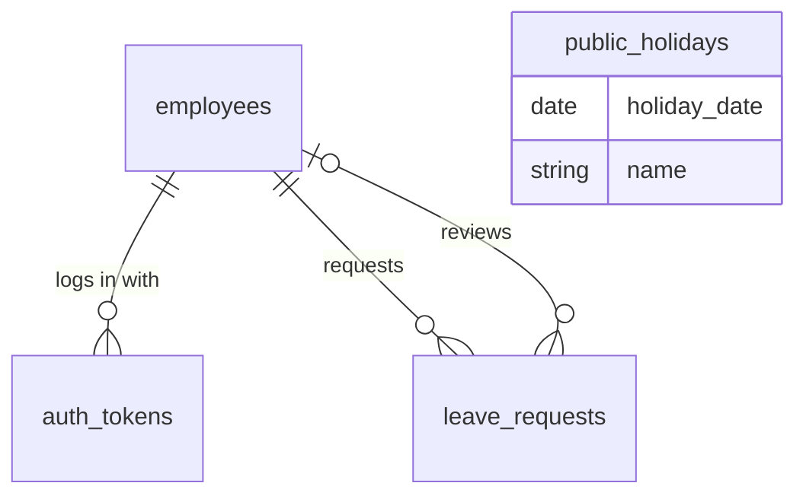

# HR Management System — Database Design

Status: **v3.0 (minimal)** — based on `REQUIREMENTS.md` v3.0. MySQL 8.0, InnoDB, `utf8mb4`.
Database: `hr_management`. **4 tables.**

## 1. Tables and relationships



| Table | Purpose |
|---|---|
| `employees` | Employee profile **and** login (email, password hash, role) |
| `auth_tokens` | Active login tokens (hashed) |
| `leave_requests` | Leave requests and their approval |
| `public_holidays` | Days not counted as leave (stand-alone list, no foreign keys) |

Conventions: plural `snake_case` table names, `id INT UNSIGNED AUTO_INCREMENT` keys, `<table>_id` foreign
keys, `created_at` / `updated_at` timestamps. Records are never deleted, so foreign keys use
`ON DELETE RESTRICT`; only `auth_tokens` cascades.

## 2. `employees`

| Column | Type | Null | Notes |
|---|---|---|---|
| `id` | INT UNSIGNED PK AI | no | |
| `employee_code` | VARCHAR(20) | no | **UNIQUE**, e.g. `EMP-0001` |
| `first_name`, `last_name` | VARCHAR(50) | no | |
| `email` | VARCHAR(150) | no | **UNIQUE** — the login name |
| `phone` | VARCHAR(30) | yes | |
| `job_title` | VARCHAR(100) | no | |
| `department` | VARCHAR(100) | no | plain text, e.g. "Engineering" |
| `hire_date` | DATE | no | |
| `status` | ENUM('active','terminated') | no | default `active` |
| `termination_date` | DATE | yes | set exactly when terminated (CHECK) |
| `role` | ENUM('hr','employee') | no | default `employee` |
| `password_hash` | VARCHAR(255) | no | `password_hash()` — never returned by the API |
| `last_login_at` | DATETIME | yes | |
| `created_at`, `updated_at` | TIMESTAMP | no | |

## 3. `auth_tokens`

| Column | Type | Null | Notes |
|---|---|---|---|
| `id` | INT UNSIGNED PK AI | no | |
| `employee_id` | INT UNSIGNED | no | FK → `employees.id`, ON DELETE CASCADE |
| `token_hash` | CHAR(64) | no | **UNIQUE** — `hash('sha256', $token)` |
| `expires_at` | DATETIME | no | login time + 8 hours |
| `created_at` | TIMESTAMP | no | |

The client gets the real token once; the database stores only its hash. Each request: hash the incoming
token and find a row with `expires_at` in the future (pass the current time from PHP).

## 4. `leave_requests`

| Column | Type | Null | Notes |
|---|---|---|---|
| `id` | INT UNSIGNED PK AI | no | |
| `employee_id` | INT UNSIGNED | no | FK → `employees.id` |
| `type` | ENUM('annual','sick') | no | rules per type are fixed in the code (REQUIREMENTS LEAVE-1) |
| `start_date`, `end_date` | DATE | no | same year, end ≥ start (CHECK) |
| `days` | SMALLINT UNSIGNED | no | working days, calculated by PHP at submit (> 0, CHECK) |
| `reason` | VARCHAR(255) | yes | |
| `status` | ENUM('pending','approved','rejected','cancelled') | no | default `pending` |
| `reviewed_by` | INT UNSIGNED | yes | FK → `employees.id` — the HR person who decided |
| `review_comment` | VARCHAR(255) | yes | required when rejecting (PHP) |
| `reviewed_at` | DATETIME | yes | |
| `created_at`, `updated_at` | TIMESTAMP | no | |

Indexes: (`employee_id`, `status`), (`status`).

**Remaining days** are calculated, not stored:

```sql
SELECT COALESCE(SUM(days), 0) AS used_days
FROM leave_requests
WHERE employee_id = ? AND type = ? AND status = 'approved' AND YEAR(start_date) = ?;
-- remaining = days per year (21 or 10) − used_days
```

Cancelling approved leave returns the days automatically, because the row is no longer `approved`.

## 5. `public_holidays`

| Column | Type | Null | Notes |
|---|---|---|---|
| `id` | INT UNSIGNED PK AI | no | |
| `holiday_date` | DATE | no | **UNIQUE** |
| `name` | VARCHAR(100) | no | |
| `created_at` | TIMESTAMP | no | |

Filled by `database/seeds/001_public_holidays.sql`. Edit that file and run `php bin/seed.php` to change them.

## 6. Counting leave days

`days` = the dates from `start_date` to `end_date` that are not Saturday/Sunday and not in `public_holidays`.
Load the holidays in the range once (`WHERE holiday_date BETWEEN ? AND ?`), then loop over the dates with
`DateTimeImmutable` (`format('N') >= 6` = weekend). The same helper answers "what is 3 working days from
today?" for the notice rule.

## 7. Files and commands

```
database/migrations/001_create_employees.sql
                    002_create_auth_tokens.sql
                    003_create_leave_requests.sql
                    004_create_public_holidays.sql
database/seeds/001_public_holidays.sql
bin/migrate.php          php bin/migrate.php        runs migrations that haven't run yet
bin/seed.php             php bin/seed.php           (re)loads the seed files
bin/create-hr-user.php   php bin/create-hr-user.php creates the first HR login (password typed, never stored)
```

## 8. Where each rule is enforced

| Rule | Database | PHP |
|---|:-:|:-:|
| Unique employee code / email / holiday date | ✅ UNIQUE | friendly `409` |
| Termination date set exactly when terminated, ≥ hire date | ✅ CHECK | `422` message |
| Leave dates in order and in one year, days > 0 | ✅ CHECK | `422` message |
| Notice / backdate limits, overlap, balance | | ✅ |
| Who may approve, reject, cancel; reject needs a comment | | ✅ |
| Terminating cancels pending and later approved leave | | ✅ (transaction) |
