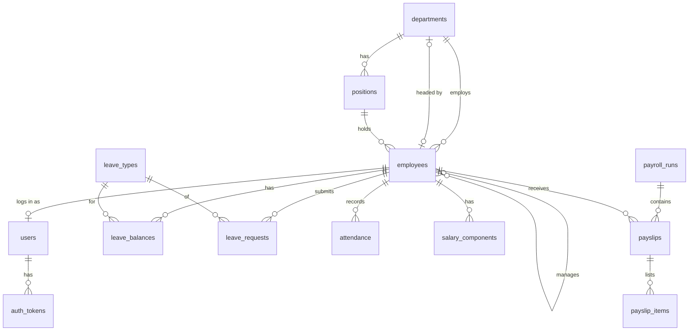

# HR Management System — Database Design

Status: **Draft v0.1** — based on `docs/REQUIREMENTS.md` v1.0.

MySQL 8.0, InnoDB, `utf8mb4`. Database name: `hr_management`.

## 1. Conventions

| Rule | Example |
|---|---|
| Table names: plural, `snake_case` | `leave_requests` |
| Primary key: `id INT UNSIGNED AUTO_INCREMENT` | `id` |
| Foreign key: `<singular table>_id` | `employee_id` → `employees.id` |
| Every table has `created_at`; editable tables also `updated_at` | `TIMESTAMP DEFAULT CURRENT_TIMESTAMP` |
| Money: `DECIMAL(12,2)` (USD) — never `FLOAT` | `base_salary` |
| Fixed list of values: `ENUM` | `status ENUM('pending','approved',...)` |
| Yes/no: `TINYINT(1)` (0/1) | `is_active` |
| Business date/time: `DATE` / `DATETIME` in company timezone | `work_date`, `check_in_at` |

### Delete behaviour

Business records are **never hard-deleted** (requirement: history matters for payroll), so almost
every foreign key uses `ON DELETE RESTRICT` (MySQL default): the database refuses to delete a row
that other rows still point to. `CASCADE` is used only for rows that are fully *owned* by a parent
and meaningless without it (`auth_tokens`, `payslips` of a draft run, `payslip_items`).

## 2. Tables overview

| # | Table | Purpose | Module |
|---|---|---|---|
| 1 | `departments` | Company departments | ORG |
| 2 | `positions` | Job titles within a department | ORG |
| 3 | `employees` | Employee profiles (the centre of everything) | EMP |
| 4 | `users` | Login accounts (one per employee who can log in) | AUTH |
| 5 | `auth_tokens` | Active login tokens | AUTH |
| 6 | `settings` | Company settings (work hours, grace period) | ATT |
| 7 | `leave_types` | Annual, Sick, Unpaid, … | LEAVE |
| 8 | `leave_balances` | Days allocated/used per employee, type and year | LEAVE |
| 9 | `leave_requests` | Leave requests and their approval | LEAVE |
| 10 | `attendance` | One row per employee per day they checked in | ATT |
| 11 | `salary_components` | Recurring allowances/deductions per employee | PAY |
| 12 | `payroll_runs` | One payroll per month | PAY |
| 13 | `payslips` | One payslip per employee per run | PAY |
| 14 | `payslip_items` | Allowance/deduction lines printed on a payslip | PAY |

## 3. Relationships (ERD)



Read `||--o{` as "one … has zero or many …". PhpStorm and GitHub render this diagram.

## 4. Tables in detail

### 4.1 `departments`

| Column | Type | Null | Notes |
|---|---|---|---|
| `id` | INT UNSIGNED PK AI | no | |
| `name` | VARCHAR(100) | no | **UNIQUE** |
| `description` | TEXT | yes | |
| `head_employee_id` | INT UNSIGNED | yes | FK → `employees.id` (ORG-1) |
| `created_at`, `updated_at` | TIMESTAMP | no | |

> **Circular reference:** a department points to its head (an employee) and an employee points to
> their department. Neither table can be created first with both foreign keys, so `departments` is
> created *without* the `head_employee_id` foreign key, and a later migration adds it with
> `ALTER TABLE` once `employees` exists.

### 4.2 `positions`

| Column | Type | Null | Notes |
|---|---|---|---|
| `id` | INT UNSIGNED PK AI | no | |
| `department_id` | INT UNSIGNED | no | FK → `departments.id` |
| `title` | VARCHAR(100) | no | |
| `min_salary` | DECIMAL(12,2) | yes | optional salary range (ORG-2) |
| `max_salary` | DECIMAL(12,2) | yes | |
| `created_at`, `updated_at` | TIMESTAMP | no | |

**UNIQUE** (`department_id`, `title`) — the same title can exist in different departments.

### 4.3 `employees`

| Column | Type | Null | Notes |
|---|---|---|---|
| `id` | INT UNSIGNED PK AI | no | |
| `employee_code` | VARCHAR(20) | no | **UNIQUE**, e.g. `EMP-0001` |
| `first_name` | VARCHAR(50) | no | |
| `last_name` | VARCHAR(50) | no | |
| `email` | VARCHAR(150) | no | **UNIQUE** — also the login email |
| `phone` | VARCHAR(30) | yes | employee-editable (EMP-2) |
| `date_of_birth` | DATE | yes | |
| `gender` | ENUM('male','female') | yes | |
| `national_id` | VARCHAR(30) | yes | **UNIQUE** |
| `address` | VARCHAR(255) | yes | employee-editable (EMP-2) |
| `department_id` | INT UNSIGNED | no | FK → `departments.id` |
| `position_id` | INT UNSIGNED | no | FK → `positions.id` |
| `manager_id` | INT UNSIGNED | yes | FK → `employees.id` (self-reference, ORG-4) |
| `employment_type` | ENUM('full_time','part_time','contract') | no | |
| `base_salary` | DECIMAL(12,2) | no | monthly, USD (PAY-1) |
| `hire_date` | DATE | no | |
| `status` | ENUM('active','terminated') | no | default `active` (EMP-3) |
| `termination_date` | DATE | yes | set when status → `terminated` |
| `created_at`, `updated_at` | TIMESTAMP | no | |

Extra index: `status` (most lists show active employees only).
"Can't be own manager" (ORG-4) is checked in PHP before saving.

### 4.4 `users`

| Column | Type | Null | Notes |
|---|---|---|---|
| `id` | INT UNSIGNED PK AI | no | |
| `employee_id` | INT UNSIGNED | no | FK → `employees.id`, **UNIQUE** (one account per employee) |
| `password_hash` | VARCHAR(255) | no | from `password_hash()` (AUTH-2) |
| `role` | ENUM('admin','hr','manager','employee') | no | |
| `is_active` | TINYINT(1) | no | default 1 (AUTH-5) |
| `last_login_at` | DATETIME | yes | |
| `created_at`, `updated_at` | TIMESTAMP | no | |

> **Why no `email` column here?** The email already lives in `employees`. Storing it twice means
> it can get out of sync. Login looks the user up with a join:
> `SELECT u.* FROM users u JOIN employees e ON e.id = u.employee_id WHERE e.email = ?`

### 4.5 `auth_tokens`

| Column | Type | Null | Notes |
|---|---|---|---|
| `id` | INT UNSIGNED PK AI | no | |
| `user_id` | INT UNSIGNED | no | FK → `users.id`, **ON DELETE CASCADE** |
| `token_hash` | CHAR(64) | no | **UNIQUE** — SHA-256 of the token |
| `expires_at` | DATETIME | no | e.g. now + 8 hours |
| `created_at` | TIMESTAMP | no | |

> **Why store a hash?** The client gets the real random token once (at login). The database keeps
> only `hash('sha256', $token)`, so a leaked database can't be used to log in. On each request:
> hash the incoming token and look it up. Logout (AUTH-3) = delete the row.

### 4.6 `settings`

| Column | Type | Null | Notes |
|---|---|---|---|
| `setting_key` | VARCHAR(50) PK | no | (`key` is a reserved word in MySQL) |
| `setting_value` | VARCHAR(255) | no | |
| `updated_at` | TIMESTAMP | no | |

Seeded rows: `work_start = 09:00`, `work_end = 17:00`, `late_grace_minutes = 15`,
`timezone = UTC` (change to the company's timezone).

### 4.7 `leave_types`

| Column | Type | Null | Notes |
|---|---|---|---|
| `id` | INT UNSIGNED PK AI | no | |
| `name` | VARCHAR(50) | no | **UNIQUE** |
| `default_days` | SMALLINT UNSIGNED | no | days given each year (LEAVE-1) |
| `is_paid` | TINYINT(1) | no | unpaid leave reduces salary (PAY-4) |
| `is_active` | TINYINT(1) | no | default 1 — retire a type instead of deleting it |
| `created_at`, `updated_at` | TIMESTAMP | no | |

Seeded rows: Annual (21, paid), Sick (10, paid), Unpaid (0, unpaid).

### 4.8 `leave_balances`

| Column | Type | Null | Notes |
|---|---|---|---|
| `id` | INT UNSIGNED PK AI | no | |
| `employee_id` | INT UNSIGNED | no | FK → `employees.id` |
| `leave_type_id` | INT UNSIGNED | no | FK → `leave_types.id` |
| `year` | SMALLINT UNSIGNED | no | calendar year (LEAVE-10) |
| `allocated_days` | SMALLINT UNSIGNED | no | copied from `leave_types.default_days` |
| `used_days` | SMALLINT UNSIGNED | no | default 0, increased on approval (LEAVE-8) |
| `created_at`, `updated_at` | TIMESTAMP | no | |

**UNIQUE** (`employee_id`, `leave_type_id`, `year`).

- `remaining = allocated_days - used_days` is **calculated**, not stored. A stored copy could
  disagree with the other two columns.
- No carry-over (LEAVE-10): a new year simply gets new rows; old rows stay as history.
- Only **paid** types need balance rows; unpaid leave has no limit.

### 4.9 `leave_requests`

| Column | Type | Null | Notes |
|---|---|---|---|
| `id` | INT UNSIGNED PK AI | no | |
| `employee_id` | INT UNSIGNED | no | FK → `employees.id` — who is going on leave |
| `leave_type_id` | INT UNSIGNED | no | FK → `leave_types.id` |
| `start_date` | DATE | no | |
| `end_date` | DATE | no | `>= start_date` (checked in PHP) |
| `days` | SMALLINT UNSIGNED | no | working days, Mon–Fri (LEAVE-4) — saved at submit |
| `reason` | TEXT | yes | |
| `status` | ENUM('pending','approved','rejected','cancelled') | no | default `pending` (LEAVE-6) |
| `reviewer_id` | INT UNSIGNED | yes | FK → `employees.id` — who approved/rejected |
| `review_comment` | TEXT | yes | |
| `reviewed_at` | DATETIME | yes | |
| `created_at`, `updated_at` | TIMESTAMP | no | |

Extra index: (`employee_id`, `status`) and (`status`) for "pending approvals" lists.

> **Approval must use a transaction:** set `status = 'approved'` **and** increase
> `leave_balances.used_days` together — if one fails, neither happens.

### 4.10 `attendance`

| Column | Type | Null | Notes |
|---|---|---|---|
| `id` | INT UNSIGNED PK AI | no | |
| `employee_id` | INT UNSIGNED | no | FK → `employees.id` |
| `work_date` | DATE | no | |
| `check_in_at` | DATETIME | yes | set by server time (ATT-1) |
| `check_out_at` | DATETIME | yes | null until checkout |
| `status` | ENUM('present','late','absent') | no | `late` decided at check-in (ATT-3) |
| `corrected_by` | INT UNSIGNED | yes | FK → `employees.id` (HR who corrected, ATT-5) |
| `correction_reason` | VARCHAR(255) | yes | |
| `corrected_at` | DATETIME | yes | |
| `created_at`, `updated_at` | TIMESTAMP | no | |

**UNIQUE** (`employee_id`, `work_date`) — enforces "one check-in per day" in the database itself.

> **What about weekends, leave and absence?** Rows exist only when someone checks in (or HR
> corrects a day). The monthly report (ATT-6) works out each Mon–Fri day:
> approved leave → `on_leave`; a row exists → its status; no row → `absent`.
> Saturdays/Sundays are `weekend`. Work hours (ATT-2) are calculated from the two times.

### 4.11 `salary_components`

| Column | Type | Null | Notes |
|---|---|---|---|
| `id` | INT UNSIGNED PK AI | no | |
| `employee_id` | INT UNSIGNED | no | FK → `employees.id` |
| `type` | ENUM('allowance','deduction') | no | |
| `name` | VARCHAR(100) | no | e.g. "Housing", "Insurance" |
| `amount` | DECIMAL(12,2) | no | monthly, USD, always positive |
| `is_active` | TINYINT(1) | no | default 1 |
| `created_at`, `updated_at` | TIMESTAMP | no | |

### 4.12 `payroll_runs`

| Column | Type | Null | Notes |
|---|---|---|---|
| `id` | INT UNSIGNED PK AI | no | |
| `period_year` | SMALLINT UNSIGNED | no | |
| `period_month` | TINYINT UNSIGNED | no | 1–12 |
| `status` | ENUM('draft','finalized') | no | default `draft` (PAY-5) |
| `created_by` | INT UNSIGNED | no | FK → `employees.id` |
| `finalized_at` | DATETIME | yes | |
| `created_at`, `updated_at` | TIMESTAMP | no | |

**UNIQUE** (`period_year`, `period_month`) — a month can't be paid twice.

### 4.13 `payslips`

| Column | Type | Null | Notes |
|---|---|---|---|
| `id` | INT UNSIGNED PK AI | no | |
| `payroll_run_id` | INT UNSIGNED | no | FK → `payroll_runs.id`, **ON DELETE CASCADE** |
| `employee_id` | INT UNSIGNED | no | FK → `employees.id` |
| `base_salary` | DECIMAL(12,2) | no | copied at run time |
| `total_allowances` | DECIMAL(12,2) | no | |
| `total_deductions` | DECIMAL(12,2) | no | |
| `unpaid_leave_days` | SMALLINT UNSIGNED | no | |
| `unpaid_leave_deduction` | DECIMAL(12,2) | no | PAY-4 |
| `net_salary` | DECIMAL(12,2) | no | PAY-3 |
| `created_at` | TIMESTAMP | no | |

**UNIQUE** (`payroll_run_id`, `employee_id`).

> **Why copy the salary instead of joining `employees.base_salary`?** A payslip is a historical
> document. If the employee gets a raise in June, their March payslip must still show the March
> salary. This "snapshot" is the one deliberate duplication in the design.
>
> Recalculating a **draft** run = delete its payslips (items cascade) and generate them again.
> A **finalized** run is never modified — enforced in PHP.

### 4.14 `payslip_items`

| Column | Type | Null | Notes |
|---|---|---|---|
| `id` | INT UNSIGNED PK AI | no | |
| `payslip_id` | INT UNSIGNED | no | FK → `payslips.id`, **ON DELETE CASCADE** |
| `type` | ENUM('allowance','deduction') | no | |
| `name` | VARCHAR(100) | no | copied from `salary_components` |
| `amount` | DECIMAL(12,2) | no | |

No timestamps — items are created together with their payslip and never edited.

## 5. Migration order

Each file in `database/migrations/` creates one table. A table must come after every table it
points to:

```
001_create_departments.sql         (without head_employee_id FK)
002_create_positions.sql
003_create_employees.sql
004_add_department_head_fk.sql     (ALTER TABLE departments ADD FOREIGN KEY ...)
005_create_users.sql
006_create_auth_tokens.sql
007_create_settings.sql
008_create_leave_types.sql
009_create_leave_balances.sql
010_create_leave_requests.sql
011_create_attendance.sql
012_create_salary_components.sql
013_create_payroll_runs.sql
014_create_payslips.sql
015_create_payslip_items.sql
```

Build them module by module, following the backend phases — you don't need all 15 on day one:
Departments → (Auth: 003–006) → Positions/Employees → Leave → Attendance → Payroll.

## 6. Seed data

Seeds are kept separate from migrations (`database/seeds/`):

- `settings` — work hours, grace period, timezone.
- `leave_types` — Annual, Sick, Unpaid.
- **First admin** — one department, position, employee and `users` row with role `admin`.
  The password is passed when running the seed script, never written in a committed file.

## 7. Where each rule is enforced

| Rule | Database | PHP |
|---|:-:|:-:|
| Unique email / employee code / national ID | ✅ UNIQUE | friendly error message |
| One check-in per day | ✅ UNIQUE | friendly error message |
| One payroll per month | ✅ UNIQUE | friendly error message |
| Can't delete a department/employee in use | ✅ FK RESTRICT | friendly error message |
| Leave ≤ remaining balance, no overlap | | ✅ |
| Not your own manager / approver | | ✅ |
| `end_date >= start_date` | | ✅ |
| Finalized payroll is read-only | | ✅ |
| Approve leave + update balance together | | ✅ transaction |
