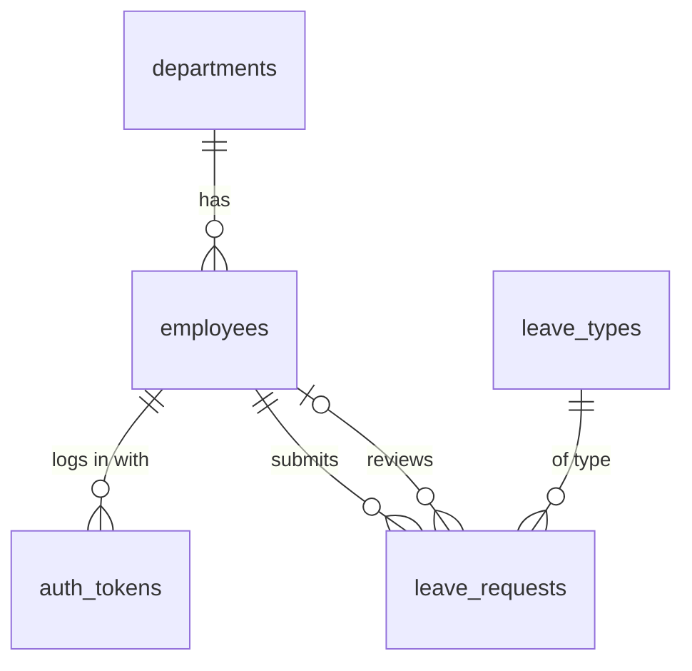

# HR Management System — Database Design

Status: **v2.0 (simplified)** — based on `docs/REQUIREMENTS.md` v2.0.

MySQL 8.0, InnoDB, `utf8mb4`. Database name: `hr_management`. **5 tables.**

## 1. Conventions

| Rule | Example |
|---|---|
| Table names: plural, `snake_case` | `leave_requests` |
| Primary key: `id INT UNSIGNED AUTO_INCREMENT` | `id` |
| Foreign key: `<singular table>_id` | `employee_id` → `employees.id` |
| Editable tables have `created_at` and `updated_at` | `TIMESTAMP DEFAULT CURRENT_TIMESTAMP` |
| Fixed list of values: `ENUM` | `status ENUM('active','terminated')` |
| Dates: `DATE`, date-times: `DATETIME` / `TIMESTAMP` | `start_date` |

Records are never hard-deleted, so foreign keys use `ON DELETE RESTRICT` (the MySQL default): the
database refuses to delete a row that others still point to. Only `auth_tokens` uses `CASCADE`.

## 2. Tables and relationships

| # | Table | Purpose |
|---|---|---|
| 1 | `departments` | Company departments |
| 2 | `employees` | Employee profiles **and** their login (email, password, role) |
| 3 | `auth_tokens` | Active login tokens |
| 4 | `leave_types` | Annual and Sick, with days per year |
| 5 | `leave_requests` | Leave requests and their approval |



Read `||--o{` as "one … has zero or many …".

## 3. Tables in detail

### 3.1 `departments`

| Column | Type | Null | Notes |
|---|---|---|---|
| `id` | INT UNSIGNED PK AI | no | |
| `name` | VARCHAR(100) | no | **UNIQUE** |
| `description` | VARCHAR(255) | yes | |
| `created_at`, `updated_at` | TIMESTAMP | no | |

### 3.2 `employees`

| Column | Type | Null | Notes |
|---|---|---|---|
| `id` | INT UNSIGNED PK AI | no | |
| `employee_code` | VARCHAR(20) | no | **UNIQUE**, e.g. `EMP-0001` |
| `first_name` | VARCHAR(50) | no | |
| `last_name` | VARCHAR(50) | no | |
| `email` | VARCHAR(150) | no | **UNIQUE** — also the login name |
| `phone` | VARCHAR(30) | yes | |
| `job_title` | VARCHAR(100) | no | plain text, e.g. "Backend Developer" |
| `department_id` | INT UNSIGNED | no | FK → `departments.id` |
| `hire_date` | DATE | no | |
| `status` | ENUM('active','terminated') | no | default `active` |
| `termination_date` | DATE | yes | set when terminated |
| `role` | ENUM('hr','employee') | no | default `employee` |
| `password_hash` | VARCHAR(255) | no | from `password_hash()` |
| `last_login_at` | DATETIME | yes | |
| `created_at`, `updated_at` | TIMESTAMP | no | |

> **Why keep login data in `employees`?** In this version every employee can log in, so a separate
> `users` table would be a 1-to-1 copy. One table means one insert, no join at login, and nothing to
> keep in sync. **Never** return `password_hash` from the API.

### 3.3 `auth_tokens`

| Column | Type | Null | Notes |
|---|---|---|---|
| `id` | INT UNSIGNED PK AI | no | |
| `employee_id` | INT UNSIGNED | no | FK → `employees.id`, **ON DELETE CASCADE** |
| `token_hash` | CHAR(64) | no | **UNIQUE** — `hash('sha256', $token)` |
| `expires_at` | DATETIME | no | e.g. now + 8 hours |
| `created_at` | TIMESTAMP | no | |

> The client receives the random token once at login; the database stores only its SHA-256 hash, so
> a leaked database can't be used to log in. Each request: hash the incoming token and look it up
> (`WHERE token_hash = ? AND expires_at > NOW()`). Logout = delete the row.

### 3.4 `leave_types`

| Column | Type | Null | Notes |
|---|---|---|---|
| `id` | INT UNSIGNED PK AI | no | |
| `name` | VARCHAR(50) | no | **UNIQUE** |
| `days_per_year` | SMALLINT UNSIGNED | no | |

Filled once by the seed script: **Annual (21)**, **Sick (10)**. There is no API to change them.

### 3.5 `leave_requests`

| Column | Type | Null | Notes |
|---|---|---|---|
| `id` | INT UNSIGNED PK AI | no | |
| `employee_id` | INT UNSIGNED | no | FK → `employees.id` — who is going on leave |
| `leave_type_id` | INT UNSIGNED | no | FK → `leave_types.id` |
| `start_date` | DATE | no | |
| `end_date` | DATE | no | same year as `start_date` |
| `days` | SMALLINT UNSIGNED | no | working days (Mon–Fri), calculated by PHP at submit |
| `reason` | VARCHAR(255) | yes | |
| `status` | ENUM('pending','approved','rejected','cancelled') | no | default `pending` |
| `reviewed_by` | INT UNSIGNED | yes | FK → `employees.id` — the HR person who decided |
| `review_comment` | VARCHAR(255) | yes | required when rejecting (checked in PHP) |
| `reviewed_at` | DATETIME | yes | |
| `created_at`, `updated_at` | TIMESTAMP | no | |

Extra index: (`employee_id`, `status`) and (`status`).

## 4. Remaining leave — calculated, not stored

There is no balances table. The remaining days for one employee, type and year are:

```sql
SELECT lt.days_per_year - COALESCE(SUM(lr.days), 0) AS remaining_days
FROM leave_types lt
LEFT JOIN leave_requests lr
       ON lr.leave_type_id = lt.id
      AND lr.employee_id = ?
      AND lr.status = 'approved'
      AND YEAR(lr.start_date) = ?
WHERE lt.id = ?
GROUP BY lt.id;
```

- No carry-over and no yearly reset job: a new year simply has no approved requests yet.
- Can never get out of sync, because nothing is copied.

## 5. Migrations and seed data

```
database/migrations/
  001_create_departments.sql
  002_create_employees.sql
  003_create_auth_tokens.sql
  004_create_leave_types.sql
  005_create_leave_requests.sql
database/seeds/
  001_leave_types.sql        Annual 21, Sick 10
  002_first_hr_user.php      one department + one HR employee; password typed when running it
```

Each table comes after the tables it points to. The first HR password is never written in a
committed file.

## 6. Where each rule is enforced

| Rule | Database | PHP |
|---|:-:|:-:|
| Unique email / employee code / department name | ✅ UNIQUE | friendly `409` message |
| Can't delete a department that has employees | ✅ FK RESTRICT | friendly `409` message |
| Dates valid, same year, at least one working day | | ✅ |
| No overlap, enough remaining days | | ✅ |
| Reject needs a comment; HR can't review own request | | ✅ |
| Terminated employees can't log in | | ✅ |
